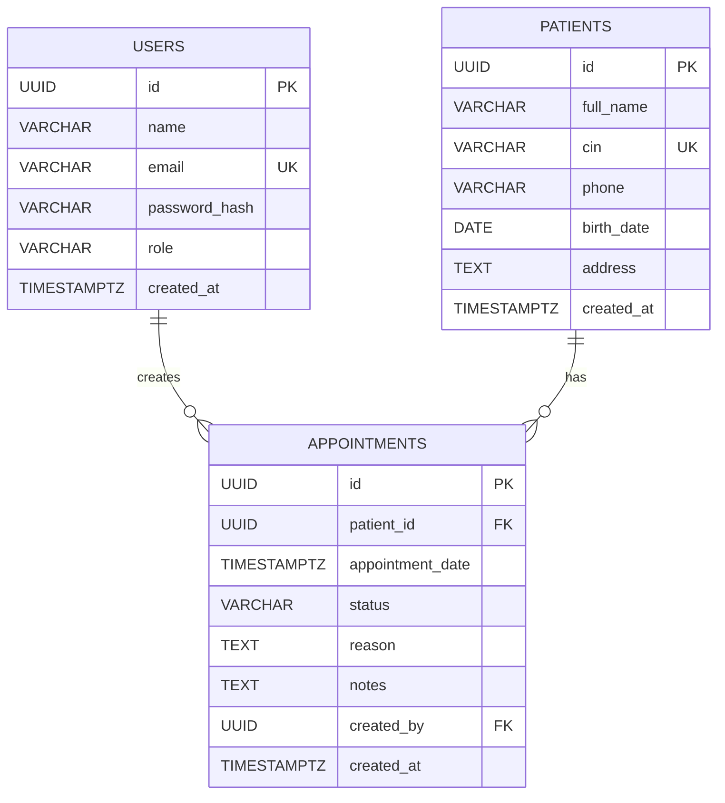

# ClinicFlow — Database Design

## 1. Overview

ClinicFlow uses PostgreSQL as its relational database.

The database is designed to manage:
- User accounts and access roles.
- Patient medical appointment scheduling.
- Appointment status and creation history.

The design prioritizes data integrity, referential integrity, query performance,
and the prevention of conflicting confirmed appointments.

The core entities are `users`, `patients`, and `appointments`.

> This document describes the intended logical design. Physical column names,
> data types, constraints, and deletion behavior must match the actual
> migrations or schema committed in this repository.

## 2. Entity Relationship Diagram (ERD)

### ERD notation

- `PK`: Primary Key.
- `FK`: Foreign Key.
- `UK`: Unique Key.
- `||`: Exactly one related record.
- `o{`: Zero or many related records.

The diagram represents the logical model. Optional fields, defaults,
soft-delete columns, and additional constraints should be updated to match
the actual database schema.

## 3. Entity descriptions

### 3.1 Users

The `users` table stores application accounts.

| Column | Purpose |
|---|---|
| `id` | UUID primary key |
| `name` | User's display name, if implemented |
| `email` | Unique login identifier |
| `password_hash` | Bcrypt password hash |
| `role` | `admin` or `staff` |
| `created_at` | Account creation timestamp |

The email must be unique to prevent multiple accounts from sharing the same
login identifier. Passwords must never be stored in plaintext.

### 3.2 Patients

The `patients` table stores patient information.

| Column | Purpose |
|---|---|
| `id` | UUID primary key |
| `full_name` | Patient's full name |
| `cin` | Unique national identity identifier |
| `phone` | Contact number |
| `birth_date` | Date of birth |
| `address` | Optional address |
| `created_at` | Record creation timestamp |

The `cin` column has a UNIQUE constraint because two patient records must not
share the same CIN.

### 3.3 Appointments

The `appointments` table stores scheduled appointments.

| Column | Purpose |
|---|---|
| `id` | UUID primary key |
| `patient_id` | Foreign key referencing `patients.id` |
| `appointment_date` | Appointment date and time |
| `status` | `pending`, `confirmed`, or `cancelled` |
| `reason` | Reason for the appointment |
| `notes` | Optional additional information |
| `created_by` | Foreign key referencing `users.id` |
| `created_at` | Record creation timestamp |

The `created_by` value should come from the authenticated user's identity,
not from an arbitrary user ID supplied by the client.

## 4. Relationship justification

### 4.1 Patient → Appointment (One-to-Many)

**Relationship:** One patient can have multiple appointments, while each
appointment belongs to exactly one patient.

**Implementation:** `appointments.patient_id` references `patients.id`.

**Justification:** A patient may visit the clinic multiple times. Storing
appointments separately avoids duplicating patient information in every
appointment record and makes appointment history easier to retrieve.

### 4.2 User → Appointment (One-to-Many)

**Relationship:** One user can create multiple appointments, while each
appointment records one creator.

**Implementation:** `appointments.created_by` references `users.id`.

**Justification:** This records responsibility for appointment creation and
provides a foundation for accountability and future audit capabilities.

### 4.3 User → Role

**Relationship:** A user's role is stored as a single value.

**Implementation:** The `users.role` column contains `admin` or `staff`.

**Justification:** The requirements define only two roles. A separate roles
table and a many-to-many relationship would introduce unnecessary complexity
for this scope. A PostgreSQL ENUM or CHECK constraint can restrict the
permitted values.

### 4.4 Many-to-Many relationships

No many-to-many relationship is required by the current requirements.

If the application later supports multiple doctors assigned to one appointment,
a separate appointment-doctor junction table could be introduced. That is
outside the current scope.

## 5. Integrity constraints

The database should enforce the following constraints:

| Constraint | Purpose |
|---|---|
| UUID primary keys | Provide stable record identifiers |
| Unique patient CIN | Prevent duplicate patient identities |
| Unique user email | Prevent duplicate login identifiers |
| Patient foreign key | Prevent appointments referencing nonexistent patients |
| Creator foreign key | Prevent appointments referencing nonexistent users |
| Appointment status constraint | Restrict statuses to supported values |
| Required-column constraints | Reject incomplete records |
| Appropriate deletion rules | Protect appointment history |

The actual schema determines which of these constraints use NOT NULL,
UNIQUE, FOREIGN KEY, ENUM, or CHECK.

### Referential deletion policy

Patient and user records are referenced by appointment history. Deletion
must therefore be deliberate.

A restrictive foreign-key policy is a reasonable default: a patient or user
cannot be physically deleted while referenced records would be orphaned.
Alternatively, the application can use soft deletion where supported.

Cascading deletion should only be used when it is explicitly appropriate,
because deleting a patient must not unintentionally erase important
appointment history.

## 6. Indexing strategy

Indexes should support the queries used by the application.

- `patients.cin`: unique index for uniqueness and exact CIN lookup.
- `users.email`: unique index for login lookup.
- `appointments.patient_id`: supports retrieval of a patient's appointment history.
- `appointments.created_by`: supports queries by appointment creator.
- `appointments.appointment_date`: supports date-based appointment filtering.
- `appointments.status`: may support status filtering.
- Patient name search: use an index appropriate to the actual search operation.

A standard B-tree index may help exact or prefix searches, but does not
automatically optimize substring searches such as `ILIKE '%term%'`.
For larger datasets, PostgreSQL trigram indexing can be considered.

Indexes should be selected based on actual query patterns rather than added
indiscriminately, because they consume storage and add write overhead.

## 7. Business rule: 30-minute appointment window

**Requirement:** A patient cannot have two confirmed appointments within a
30-minute window.

The rule must be checked when:
1. A new appointment is created as confirmed.
2. A pending appointment is changed to confirmed.

The check must consider other confirmed appointments for the same patient
and must exclude the appointment currently being updated.

For a simple application-level check, the service queries for a conflicting
appointment before performing the write.

However, a check followed by an insert can suffer from a race condition when
two requests run concurrently. A stronger implementation uses a suitable
database constraint or transaction/locking strategy to protect concurrent
writes.

The exact implementation must match the repository's SQL migration and
appointment service. The phrase "within 30 minutes" should also be defined
consistently, including whether appointments exactly 30 minutes apart are
permitted.

## 8. Query and transaction considerations

- Use parameterized SQL queries to protect against SQL injection.
- Perform validation before executing database operations.
- Use database transactions when a business operation requires multiple
  related writes to succeed or fail together.
- Handle unique-constraint and foreign-key violations without exposing
  internal database details to clients.
- Use pagination for patient listings to avoid loading all records at once.
- Retrieve dashboard statistics through aggregate queries rather than
  loading every record into application memory.

## 9. Design decisions

### Why PostgreSQL?

Patient and appointment records have clear relationships, and the application
requires uniqueness, foreign keys, and transactional consistency. PostgreSQL
provides these relational database capabilities.

### Why UUID primary keys?

UUIDs provide stable identifiers without relying on sequential IDs. They are
suitable for API resource identifiers and can be generated independently
of database row order.

### Why separate patients and appointments?

Patient details are stored once and referenced by appointments. This reduces
unnecessary duplication and allows appointment history to be maintained
independently of patient profile updates.

### Why database constraints as well as API validation?

API validation gives clients understandable error messages. Database
constraints protect integrity even when data is written through another code
path or concurrent requests.

## 10. Scope and future improvements

Potential improvements, depending on business requirements, include:

- Soft deletion with `deleted_at`.
- Audit logging for sensitive changes.
- Automated database integration tests.
- More advanced patient search indexes.
- Doctor availability and appointment duration management.

These are future enhancements unless they are already implemented.

## 11. Conclusion

The ClinicFlow data model separates users, patients, and appointments into
three related entities. One-to-many foreign-key relationships represent
appointment ownership and creation responsibility. Unique constraints,
appropriate indexes, input validation, and a concurrency-safe appointment
rule help maintain data integrity and support the application's main
workflows.
