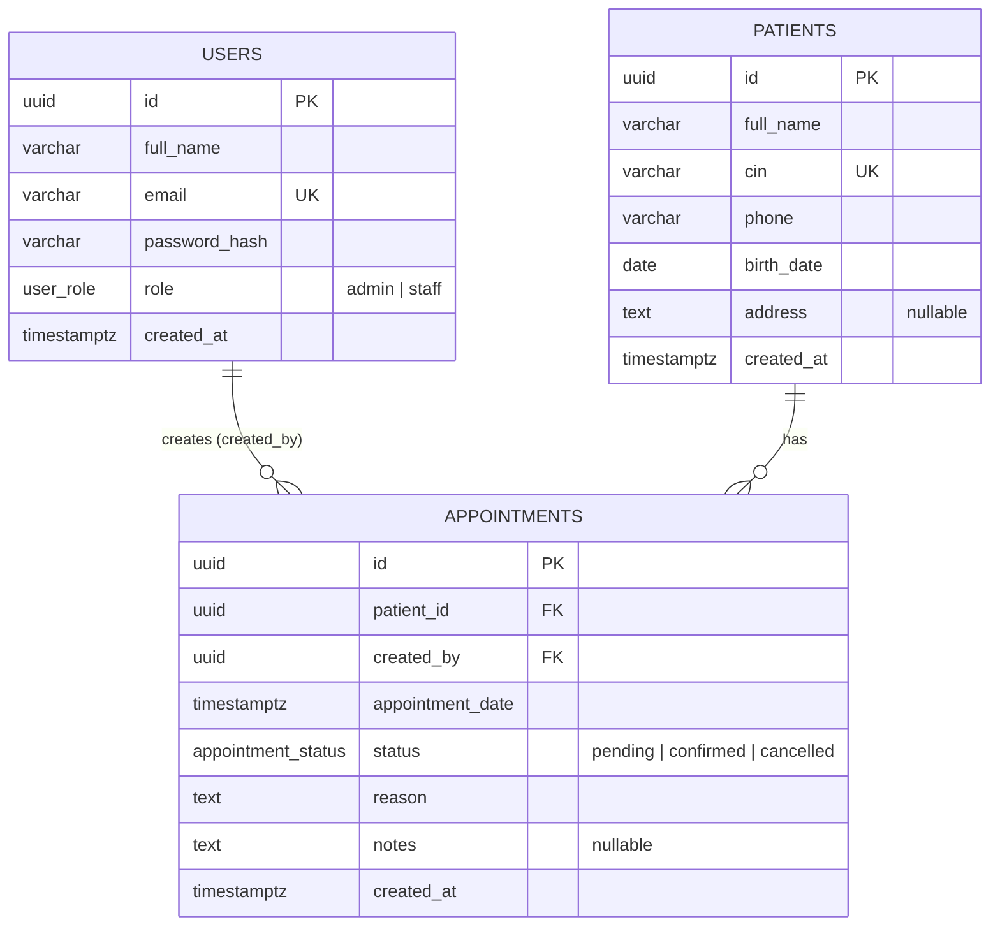

# ClinicFlow — Database Design

## ERD

GitHub renders Mermaid natively. Adjust the column names to match your real schema.

## Relationships

| Relation | Type | Justification |
|----------|------|---------------|
| patients → appointments | 1-N | One patient has many appointments; each appointment belongs to exactly one patient |
| users → appointments (`created_by`) | 1-N | A staff member creates many appointments; it tracks who booked each one |
| patients ↔ users | none | Patients are not users; they don't log in |

There is no N-N relation in this model. If doctors were added, `appointments`
would become the join entity between patients and doctors.

## Constraints

- **UUID primary keys** on all tables
- `patients.cin` **UNIQUE**; `users.email` **UNIQUE**
- `status` and `role`: <ENUM / CHECK constraint>
- **Foreign keys and cascade rules:**
  - `appointments.patient_id → patients.id` **ON DELETE <CASCADE/RESTRICT>**: <why>
  - `appointments.created_by → users.id` **ON DELETE <RESTRICT/SET NULL>**: <why>

## Indexes

| Index | Purpose |
|-------|---------|
| `patients(cin)` (unique) | Search and uniqueness |
| `patients(full_name)` <or trigram/lower()> | Search by name |
| `appointments(patient_id)` | Patient details page, FK joins |
| `appointments(appointment_date)` | Date filter, "today" on dashboard |
| `appointments(status)` | Status filter, dashboard counts |
| <composite `(patient_id, appointment_date)` WHERE status='confirmed'> | 30-min rule check |

## Business rule

> A patient cannot have two **confirmed** appointments within a 30-minute window.

**Implementation:** <describe: query checking
`appointment_date BETWEEN new - 30min AND new + 30min AND status = 'confirmed'
AND patient_id = $1 AND id <> $2`, run inside a transaction / with a lock>.

**Applied when:** an appointment is created as `confirmed`, and when an existing
one is switched to `confirmed`.

## Pagination & performance

Patients list uses `LIMIT/OFFSET` with a total count, search via `ILIKE` on
`full_name` and `cin`, backed by the indexes above.

## Bonus items implemented

- [x] Docker Compose (frontend + backend + postgres)
