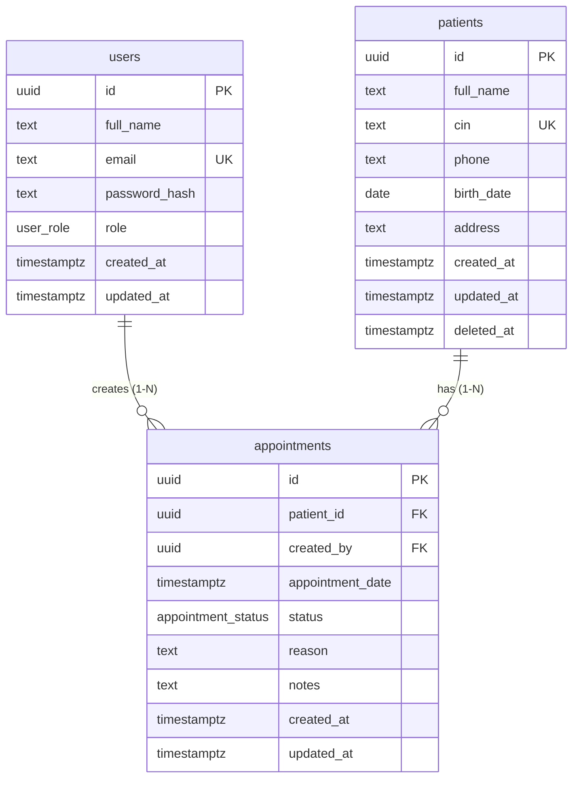

# ClinicFlow ERD

## Relations
- **patients 1-N appointments**: one patient has many appointments, and an appointment belongs to one patient. FK is `ON DELETE RESTRICT`: medical history must never disappear by accident. Patients are removed with a **soft delete** (`deleted_at`).
- **users 1-N appointments** (`created_by`): traceability of who booked. `ON DELETE RESTRICT`, so a user with history cannot be hard-deleted.
- **No N-N relation** is needed in this scope.

## Constraints and indexes
- UUID PKs (`gen_random_uuid()`), ENUMs for role and status.
- `patients.cin` UNIQUE, `users.email` UNIQUE (stored lowercase, CHECK enforced).
- Trigram GIN index on `patients.full_name` for fast `ILIKE '%x%'` search.
- Indexes on `appointments(patient_id)`, `(appointment_date)`, `(status, appointment_date)`.
- **30-minute rule enforced by the DB**: an `EXCLUDE` constraint (GiST) forbids overlapping 30-minute ranges for the same patient when `status = 'confirmed'`. This is race-condition proof, unlike a check only in code.